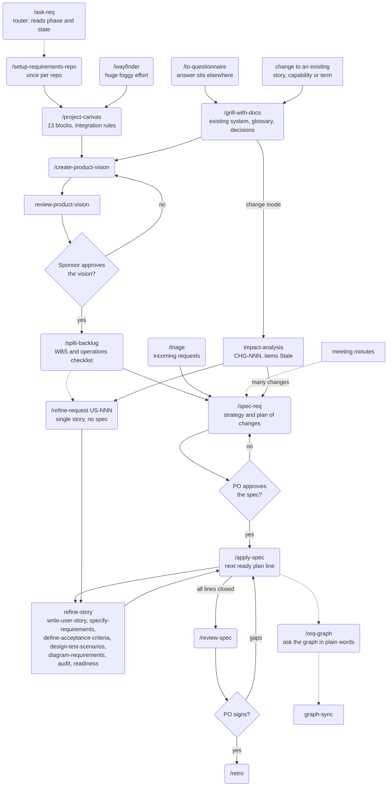

# Requirements Skills v3.1.0

Small, composable, **harness-neutral** agent skills for **eliciting and documenting requirements**. They turn a Product Owner's vision into goals and capabilities, then into specs, thin vertical user stories, requirements, Gherkin, test scenarios, Mermaid diagrams and a traceability matrix. **They never generate application code.**

The structure follows [Matt Pocock's skills](https://github.com/mattpocock/skills) (independent work, no affiliation): a router, grilling sessions, a wayfinder for foggy efforts, user-invoked orchestrators over model-invoked disciplines. The same names are used where the role is the same. See the [De/Para](docs/DE-PARA.md) (Portuguese).

## Why it exists

Requirements fail in three ways, and each has a skill:

1. **We did not understand each other.** `/grill-with-docs` interviews you round by round and records the shared language and decisions.
2. **We changed something and broke something else.** Any change to an existing story runs an **impact round** (`impact-analysis`): downstream, upstream and sideways items are classified and the affected ones become `Stale` until re-refined.
3. **We lost the thread.** Every skill ends with a **next step**, and `/ask-req` reads your artifacts to say where you are.

## Install

```bash
git clone https://github.com/gugaucb/requirements-skills
cd requirements-skills
scripts/install.sh /path/to/your/repo/.agents/skills     # Codex, Gemini CLI and other Agent Skills hosts
scripts/install.sh /path/to/your/repo/.claude/skills     # Claude Code
```

Symlinks by default (a `git pull` updates them); add `--copy` to copy. Then, in your repo, run **`/setup-requirements-repo`** once (artifact root, output language, tracker, triage roles). New here? Run **`/ask-req`**. Invocation details per harness: [docs/INVOCATION.md](docs/INVOCATION.md).

## The flow



More diagrams (on-ramps, change flow, status machine): [docs/FLOW.md](docs/FLOW.md). The diagram is a routing model, not a pipeline: a small, fully specified request skips most of it.

### The five phases

| Phase | Skill | Reads | Writes | Human gate |
| --- | --- | --- | --- | --- |
| 1 | `/project-canvas`, `/create-product-vision` | narrative, minutes | `00-canvas/`, `01-vision/` | sponsor approves the vision |
| 2 | `/split-backlog` | CAPs of the vision | `02-backlog/` (WBS, operations checklist) | PO confirms the order |
| 3 | `/spec-req` | a backlog story, a conversation, or minutes | `03-specs/` (strategy, plan of changes) | PO approves the spec |
| 4 | `/apply-spec` | the approved spec | updated artifacts, `04-stories/`, `05-changes/` | PO reviews |
| 5 | `/review-spec` | spec, changes, graph | review report in the spec | PO signs |

1. **Canvas and vision.** `/project-canvas` guides the sponsor through the 13 blocks of the Project Model Canvas and enforces its integration rules (justification, objective and benefit triad; product, requirements and deliveries; assumptions and risks; constraints against timeline and costs; reverse traceability). `/create-product-vision` derives goals and capabilities with their origin. For an existing system, start with `/grill-with-docs`.
2. **WBS and backlog.** `/split-backlog` decomposes each capability into thin vertical stories with an **operations checklist** (include, edit, remove, consult...). Status is the lifecycle; Progress is derived from the checklist.
3. **Spec.** `/spec-req` writes the strategy to meet a story, a conversation or meeting minutes, and a **plan of changes** for every artifact touched.
4. **Apply.** `/apply-spec` applies the approved plan one ready line at a time, with a single change report; stories go through `refine-story`.
5. **Review.** `/review-spec` checks conformance to the spec; the PO signs.

For a single story with no spec, `/refine-request US-NNN` still works. Humans approve at every gate; skills recommend.

### Changing a user story (HU)

`/grill-with-docs` on the change. Its last round is the **impact report**: which FR, AC, TC, sibling stories, glossary terms and decisions are touched, each marked Invalidated, Needs review or Unaffected (checked). The report is saved as `05-changes/CHG-NNN.md`, impacted items become `Stale`, and `/refine-request` clears them one by one. `Stale` blocks readiness.

## Skill catalog (32)

**User-invoked** (reachable only when you type them; they orchestrate):

| Skill | Purpose |
| --- | --- |
| [`ask-req`](skills/requirements/ask-req/SKILL.md) | Which skill or flow fits? Reads your artifacts first |
| [`setup-requirements-repo`](skills/requirements/setup-requirements-repo/SKILL.md) | Configure artifact root, tracker, language, IDs, triage roles |
| [`grill-with-docs`](skills/requirements/grill-with-docs/SKILL.md) | Interview that records glossary, decisions and change impact |
| [`grill-me`](skills/productivity/grill-me/SKILL.md) | Stateless interview; writes nothing |
| [`project-canvas`](skills/requirements/project-canvas/SKILL.md) | Guided Project Model Canvas with its integration rules (phase 1) |
| [`create-product-vision`](skills/requirements/create-product-vision/SKILL.md) | Canvas or narrative to `PRODUCT-VISION.md` with GOAL and CAP IDs and their origin |
| [`split-backlog`](skills/requirements/split-backlog/SKILL.md) | Capabilities to a WBS of stories with an operations checklist (phase 2) |
| [`spec-req`](skills/requirements/spec-req/SKILL.md) | A story, conversation or minutes to a spec with strategy and plan of changes (phase 3) |
| [`apply-spec`](skills/requirements/apply-spec/SKILL.md) | Apply the approved plan line by line, one change report (phase 4) |
| [`review-spec`](skills/requirements/review-spec/SKILL.md) | Check the result against the spec (phase 5) |
| [`refine-request`](skills/requirements/refine-request/SKILL.md) | One story, no spec: requirements, AC, tests, traceability |
| [`req-graph`](skills/requirements/req-graph/SKILL.md) | Ask the requirements graph in plain words |
| [`triage`](skills/requirements/triage/SKILL.md) | Incoming and change requests through triage roles |
| [`wayfinder`](skills/requirements/wayfinder/SKILL.md) | Map of decision tickets for huge foggy efforts |
| [`to-questionnaire`](skills/productivity/to-questionnaire/SKILL.md) | Questionnaire for a stakeholder who holds the answer |
| [`handoff`](skills/productivity/handoff/SKILL.md) | Portable summary for another agent or colleague |
| [`wait-what`](skills/productivity/wait-what/SKILL.md) | The last message did not land: re-pitch it |
| [`retro`](skills/requirements/retro/SKILL.md) | Improve the requirements environment after a session |

**Model-invoked** (the agent may reach for them; the orchestrators above invoke them):

| Skill | Purpose |
| --- | --- |
| [`grilling`](skills/productivity/grilling/SKILL.md) | Interview primitive: rounds, frontier, change mode |
| [`impact-analysis`](skills/requirements/impact-analysis/SKILL.md) | Downstream, upstream and sideways impact of a change |
| [`domain-modeling`](skills/requirements/domain-modeling/SKILL.md) | Business vocabulary and decisions |
| [`review-product-vision`](skills/requirements/review-product-vision/SKILL.md) | Review a vision for consistency and coverage |
| [`refine-story`](skills/requirements/refine-story/SKILL.md) | The refinement pipeline of one story; ticks its operations checklist |
| [`refine-story`](skills/requirements/refine-story/SKILL.md) | The refinement pipeline of one story; ticks its operations checklist |
| [`write-user-story`](skills/requirements/write-user-story/SKILL.md) | As a / I want / So that story file |
| [`specify-requirements`](skills/requirements/specify-requirements/SKILL.md) | Atomic FR and measurable NFR |
| [`define-acceptance-criteria`](skills/requirements/define-acceptance-criteria/SKILL.md) | Gherkin acceptance criteria |
| [`design-test-scenarios`](skills/requirements/design-test-scenarios/SKILL.md) | Implementation-independent test scenarios |
| [`diagram-requirements`](skills/requirements/diagram-requirements/SKILL.md) | Mermaid diagrams, only for real complexity |
| [`audit-traceability`](skills/requirements/audit-traceability/SKILL.md) | Deterministic ID check, then semantic audit |
| [`review-readiness`](skills/requirements/review-readiness/SKILL.md) | Quality gates; never PO signoff |
| [`research`](skills/requirements/research/SKILL.md) | Primary-source research into a cited file |
| [`graph-sync`](skills/requirements/graph-sync/SKILL.md) | Optional knowledge graph of every ID and link; merges with Graphify |

A user-invoked skill may invoke model-invoked ones, never another user-invoked one; for those it suggests the next step.

## Knowledge graph (optional, v2.1)

`graph-sync` turns the artifacts into a typed graph (`serves`, `part_of`, `decided_by`, `blocked_by`, `verifies`, `proves`) with a deterministic script: no LLM, no extra install, milliseconds, skipped when nothing changed. One rule keeps it simple: **an edge points at what its source depends on**, so impact flows against the arrow. That is what `graphify affected` already does, so the graph merges with [Graphify](https://github.com/Graphify-Labs/graphify) code and knowledge layers (`graphify merge-graphs`) and answers questions like "what breaks if DEC-003 changes" in one call.

```bash
python3 skills/requirements/graph-sync/scripts/req-graph.py build    artifacts/<product> --view   # JSON + interactive HTML
python3 skills/requirements/graph-sync/scripts/req-graph.py affected artifacts/<product> DEC-003 --no-weak
python3 skills/requirements/graph-sync/scripts/req-graph.py frontier artifacts/<product>
python3 skills/requirements/graph-sync/scripts/req-graph.py query    artifacts/<product> "fraud review" --type US,FR
python3 skills/requirements/graph-sync/scripts/req-graph.py path     artifacts/<product> TC-003 GOAL-001
python3 skills/requirements/graph-sync/scripts/req-graph.py explain  artifacts/<product> FR-003
```

`graph/req-graph.html` is a self-contained, offline viewer (layered layout, click a node to see what it impacts and what it depends on, status on the border, search and filters). It is regenerated with the graph and needs no Graphify.

Used by `impact-analysis` (dependents in one call), `refine-request` (loads only the upstream sections), `/ask-req` (frontier and Stale from the graph), `audit-traceability` and `/triage`. Enable it in `/setup-requirements-repo`. Details, relation table and Graphify recipes: [GRAPH.md](skills/requirements/graph-sync/GRAPH.md). Not affiliated with Graphify Labs.

## Artifacts

```text
artifacts/<product>/
├── 00-canvas/   PROJECT-CANVAS.md          # phase 1, JUS OBJ BEN PRD RQT STK PRM ENT RSK TMP CST EQP RST
├── 01-vision/   PRODUCT-VISION.md          # GOAL-, CAP- with origin
├── 02-backlog/  BACKLOG.md                 # WBS, status, progress, operations checklist
├── 03-specs/    SPEC-NNN-slug.md           # strategy and plan of changes (PLN-)
├── 04-stories/  US-NNN.md                  # FLD, SCR, FR, NFR, AC, TC and the canonical matrix
├── 05-changes/  CHG-NNN.md                 # change and impact reports
├── inputs/      minutes/ requests/ research/
├── shared/      GLOSSARY.md DECISIONS.md OUT-OF-SCOPE.md
├── wayfinder/   diagrams/
└── graph/       req-graph.json, req-graph.html   # derived, optional
```

A flat v2 layout still works (scripts recognise files by name); `setup-requirements-repo/scripts/migrate-layout.py` moves it (dry run by default).

A complete fictional trail, including a change and its impact report: [examples/order-status-portal](examples/order-status-portal/).

## Principles

Small and composable; evidence before assumptions (Confirmed, Proposed, Pending, Stale); humans approve; one source of truth per meaning; IDs immutable and product-wide; create files lazily; no forced epics or diagrams; mechanical checks over written rules.

## Guarantees (v3.1)

- **Preflight:** every `SKILL.md` starts with `## Preflight (Pré-condições / Insumos Obrigatórios)`: the files that must exist. If one is missing the skill **stops, does not invent**, names what is missing and which skill produces it, and points to `/wayfinder` when the way forward is unclear.
- **Evidence:** `project-canvas`, `audit-traceability`, `review-readiness` and `review-spec` must run their validation script **before** answering and attach the output; without a terminal the verdict is `Unverified`.
- **Return routes:** a failed gate names where to go back (`docs/FLOW.md`, "Return routes"): `BLOCKED` needs a decision or input, `NEEDS CHANGES` a mechanical fix.
- **CI exit codes** (`req-graph.py validate`, `check-ids.py`, `canvas-check.py`): `0` consistent, `1` orphan IDs or untested rules, `2` dependency cycles, `3` critical parse or file failure.
- **Lifecycle metadata** on specs and stories: YAML frontmatter `status: draft | review | approved | deprecated` and `version: X.Y.Z`.
- **Neutral manifests:** `skills/*/*/agents/agent.yaml` (generated from `SKILL.md`: invocation, required inputs, contract, scripts, next steps, an MCP-tool-shaped block) next to the Codex `openai.yaml`; `CLAUDE.md` and `GEMINI.md` point to `AGENTS.md`.

## Validate

```bash
python3 scripts/validate_repository.py
python3 -m unittest discover -s tests -v
python3 skills/requirements/audit-traceability/scripts/check-ids.py artifacts/<product>   # in your own repo
```

Static checks are not a substitute for live activation tests in your CLI or for PO review. See [manual evaluations](evaluations/MANUAL-EVALUATIONS.md).

## Docs

[Flow](docs/FLOW.md) · [De/Para](docs/DE-PARA.md) · [Invocation](docs/INVOCATION.md) · [Authoring skills](docs/AUTHORING-SKILLS.md) · [Contributing](CONTRIBUTING.md) · [Publishing](PUBLISHING.md) · [Changelog](CHANGELOG.md) · MIT [LICENSE](LICENSE)
