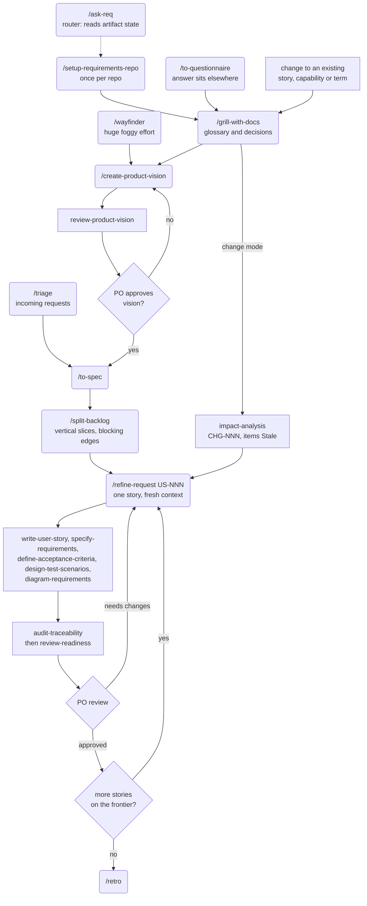

# Requirements Skills v2.0.0

Small, composable, **harness-neutral** agent skills for **eliciting and documenting requirements**. They turn a Product Owner's vision into goals and capabilities, then into specs, thin vertical user stories, requirements, Gherkin, test scenarios, Mermaid diagrams and a traceability matrix. **They never generate application code.**

The structure follows [Matt Pocock's skills](https://github.com/mattpocock/skills) (independent work, no affiliation): a router, grilling sessions, a wayfinder for foggy efforts, user-invoked orchestrators over model-invoked disciplines. The same names are used where the role is the same. See the [De/Para](docs/DE-PARA.md) (Portuguese).

## Why it exists

Requirements fail in three ways, and each has a skill:

1. **We did not understand each other.** `/grill-with-docs` interviews you round by round and records the shared language and decisions.
2. **We changed something and broke something else.** Any change to an existing story runs an **impact round** (`impact-analysis`): downstream, upstream and sideways items are classified and the affected ones become `Stale` until re-refined.
3. **We lost the thread.** Every skill ends with a **next step**, and `/ask-req` reads your artifacts to say where you are.

## Install

```bash
git clone https://github.com/gugaucb/requirements-skills
cd requirements-skills
scripts/install.sh /path/to/your/repo/.agents/skills     # Codex, Gemini CLI and other Agent Skills hosts
scripts/install.sh /path/to/your/repo/.claude/skills     # Claude Code
```

Symlinks by default (a `git pull` updates them); add `--copy` to copy. Then, in your repo, run **`/setup-requirements-repo`** once (artifact root, output language, tracker, triage roles). New here? Run **`/ask-req`**. Invocation details per harness: [docs/INVOCATION.md](docs/INVOCATION.md).

## The flow



More diagrams (on-ramps, change flow, status machine): [docs/FLOW.md](docs/FLOW.md). The diagram is a routing model, not a pipeline: a small, fully specified request skips most of it.

### Main flow in words

1. **Setup** once. 2. **Vision**: `/grill-with-docs`, `/create-product-vision`, review, PO approval recorded as a DEC. 3. **Spec**: `/to-spec`. 4. **Slice**: `/split-backlog`. 5. **Refine** each frontier story with `/refine-request` in a fresh context. 6. **Approve**: the PO reviews; humans approve, skills recommend. 7. **`/retro`**.

### Changing a user story (HU)

`/grill-with-docs` on the change. Its last round is the **impact report**: which FR, AC, TC, sibling stories, glossary terms and decisions are touched, each marked Invalidated, Needs review or Unaffected (checked). The report is saved as `changes/CHG-NNN.md`, impacted items become `Stale`, and `/refine-request` clears them one by one. `Stale` blocks readiness.

## Skill catalog (26)

**User-invoked** (reachable only when you type them; they orchestrate):

| Skill | Purpose |
| --- | --- |
| [`ask-req`](skills/requirements/ask-req/SKILL.md) | Which skill or flow fits? Reads your artifacts first |
| [`setup-requirements-repo`](skills/requirements/setup-requirements-repo/SKILL.md) | Configure artifact root, tracker, language, IDs, triage roles |
| [`grill-with-docs`](skills/requirements/grill-with-docs/SKILL.md) | Interview that records glossary, decisions and change impact |
| [`grill-me`](skills/productivity/grill-me/SKILL.md) | Stateless interview; writes nothing |
| [`create-product-vision`](skills/requirements/create-product-vision/SKILL.md) | PO narrative to `PRODUCT-VISION.md` with GOAL and CAP IDs |
| [`to-spec`](skills/requirements/to-spec/SKILL.md) | Conversation to a feature spec; no interview |
| [`split-backlog`](skills/requirements/split-backlog/SKILL.md) | Spec to thin vertical stories with blocking edges |
| [`refine-request`](skills/requirements/refine-request/SKILL.md) | One story to requirements, AC, tests and traceability |
| [`triage`](skills/requirements/triage/SKILL.md) | Incoming and change requests through triage roles |
| [`wayfinder`](skills/requirements/wayfinder/SKILL.md) | Map of decision tickets for huge foggy efforts |
| [`to-questionnaire`](skills/productivity/to-questionnaire/SKILL.md) | Questionnaire for a stakeholder who holds the answer |
| [`handoff`](skills/productivity/handoff/SKILL.md) | Portable summary for another agent or colleague |
| [`wait-what`](skills/productivity/wait-what/SKILL.md) | The last message did not land: re-pitch it |
| [`retro`](skills/requirements/retro/SKILL.md) | Improve the requirements environment after a session |

**Model-invoked** (the agent may reach for them; the orchestrators above invoke them):

| Skill | Purpose |
| --- | --- |
| [`grilling`](skills/productivity/grilling/SKILL.md) | Interview primitive: rounds, frontier, change mode |
| [`impact-analysis`](skills/requirements/impact-analysis/SKILL.md) | Downstream, upstream and sideways impact of a change |
| [`domain-modeling`](skills/requirements/domain-modeling/SKILL.md) | Business vocabulary and decisions |
| [`review-product-vision`](skills/requirements/review-product-vision/SKILL.md) | Review a vision for consistency and coverage |
| [`write-user-story`](skills/requirements/write-user-story/SKILL.md) | As a / I want / So that story file |
| [`specify-requirements`](skills/requirements/specify-requirements/SKILL.md) | Atomic FR and measurable NFR |
| [`define-acceptance-criteria`](skills/requirements/define-acceptance-criteria/SKILL.md) | Gherkin acceptance criteria |
| [`design-test-scenarios`](skills/requirements/design-test-scenarios/SKILL.md) | Implementation-independent test scenarios |
| [`diagram-requirements`](skills/requirements/diagram-requirements/SKILL.md) | Mermaid diagrams, only for real complexity |
| [`audit-traceability`](skills/requirements/audit-traceability/SKILL.md) | Deterministic ID check, then semantic audit |
| [`review-readiness`](skills/requirements/review-readiness/SKILL.md) | Quality gates; never PO signoff |
| [`research`](skills/requirements/research/SKILL.md) | Primary-source research into a cited file |

A user-invoked skill may invoke model-invoked ones, never another user-invoked one; for those it suggests the next step.

## Artifacts

```text
artifacts/<product>/
├── PRODUCT-VISION.md     # GOAL-, CAP-
├── GLOSSARY.md           # business vocabulary
├── DECISIONS.md          # DEC- (human decisions)
├── BACKLOG.md            # order, blocked-by, status
├── OUT-OF-SCOPE.md       # rejected requests
├── requests/             # incoming items for /triage
├── specs/SPEC-NNN-*.md
├── stories/US-NNN.md     # FR, NFR, AC, TC and the canonical matrix
├── changes/CHG-NNN.md    # change and impact reports
├── research/  wayfinder/  diagrams/
```

A complete fictional trail, including a change and its impact report: [examples/order-status-portal](examples/order-status-portal/).

## Principles

Small and composable; evidence before assumptions (Confirmed, Proposed, Pending, Stale); humans approve; one source of truth per meaning; IDs immutable and product-wide; create files lazily; no forced epics or diagrams; mechanical checks over written rules.

## Validate

```bash
python3 scripts/validate_repository.py
python3 -m unittest discover -s tests -v
python3 skills/requirements/audit-traceability/scripts/check-ids.py artifacts/<product>   # in your own repo
```

Static checks are not a substitute for live activation tests in your CLI or for PO review. See [manual evaluations](evaluations/MANUAL-EVALUATIONS.md).

## Docs

[Flow](docs/FLOW.md) · [De/Para](docs/DE-PARA.md) · [Invocation](docs/INVOCATION.md) · [Authoring skills](docs/AUTHORING-SKILLS.md) · [Contributing](CONTRIBUTING.md) · [Publishing](PUBLISHING.md) · [Changelog](CHANGELOG.md) · MIT [LICENSE](LICENSE)
