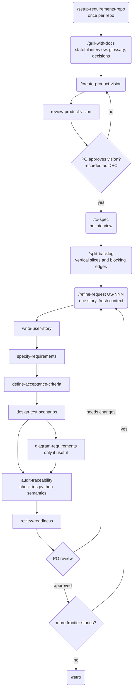
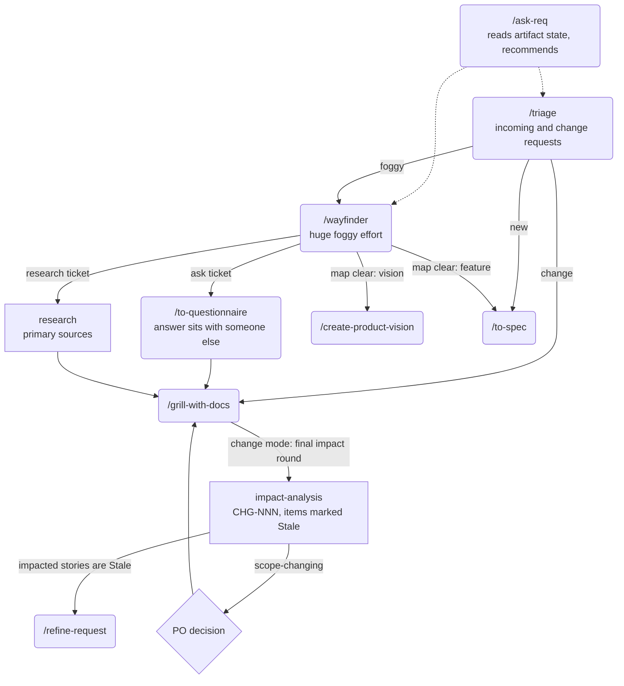
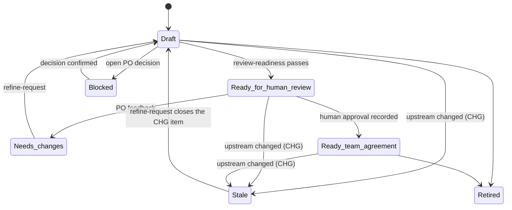

# Flow and decision gates

Skills in rounded boxes are user-invoked (you type them); plain boxes are model-invoked. The diagram is a routing model, not a pipeline: skip what the work does not need. Each skill ends by suggesting the next step.

## Main flow

## On-ramps and change flow

## Status machine of a story

Gates: no automatic approval; a scope-changing request goes to the PO as a DEC and is traced to a vision revision; `Stale` blocks readiness.
