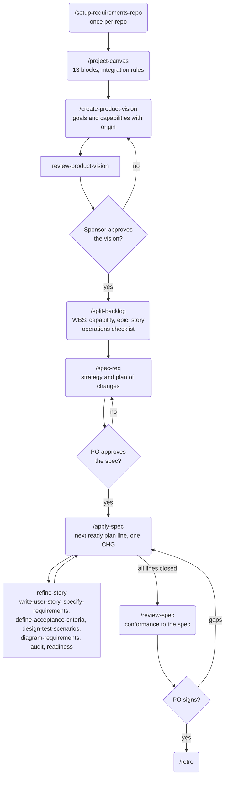
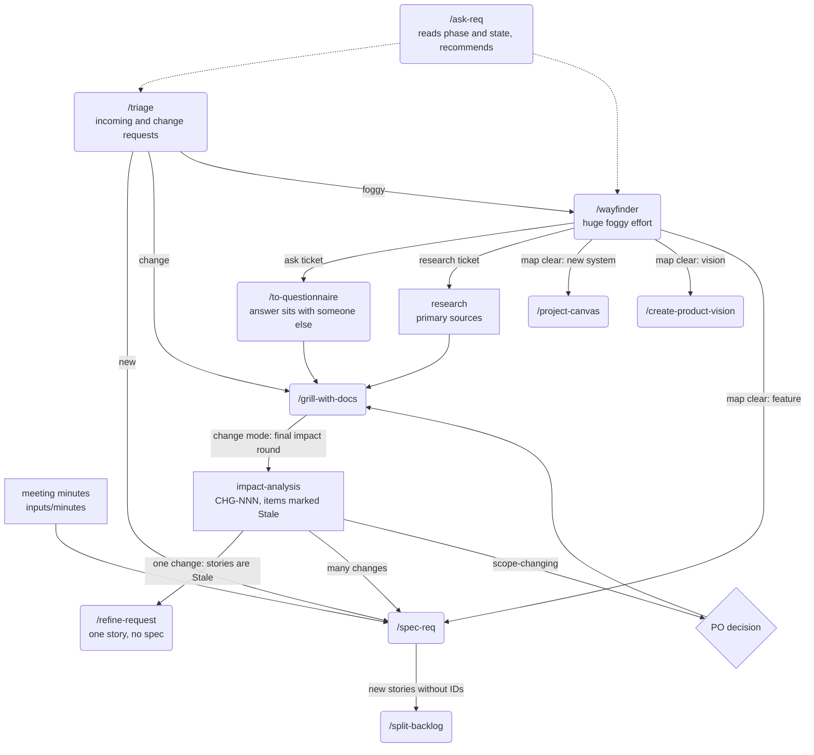
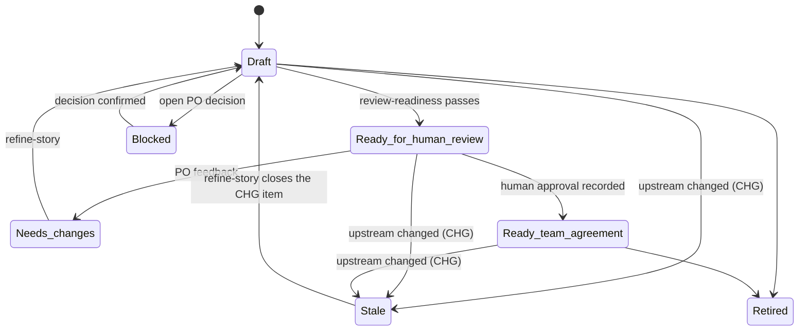
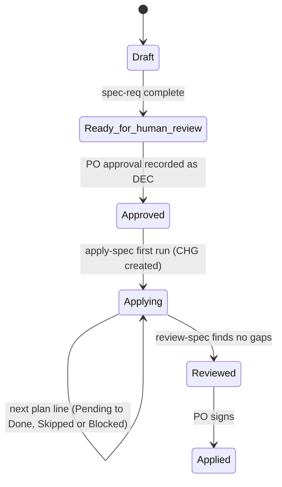
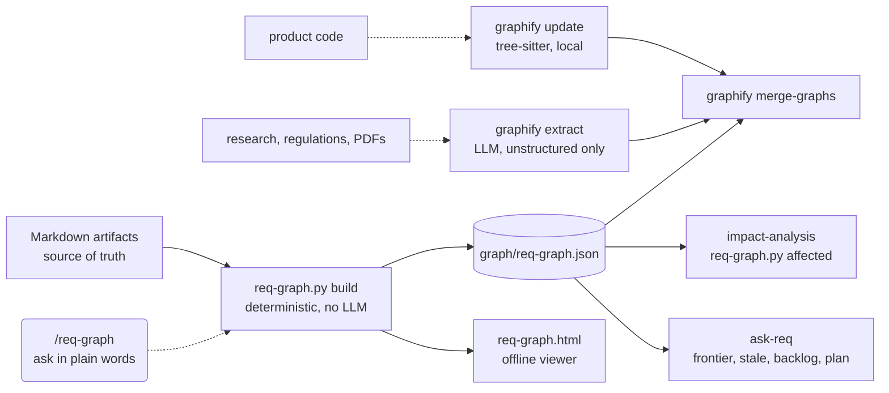
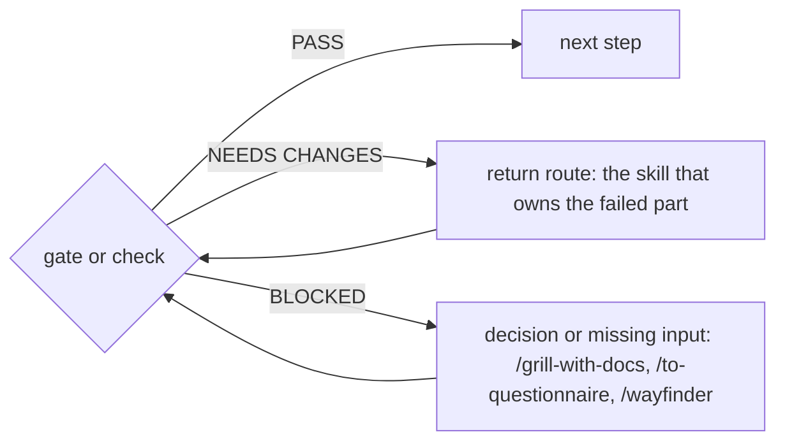

# Flow and decision gates

Skills in rounded boxes are user-invoked (you type them); plain boxes are model-invoked. The output of each phase is the input of the next. The diagrams are routing models, not pipelines: skip what the work does not need. Each skill ends by suggesting the next step, and `/ask-req` reads your artifacts to say where you are.

## The five phases

| Phase | Skill | Reads | Writes | Human gate |
| --- | --- | --- | --- | --- |
| 1 | `/project-canvas`, `/create-product-vision` | narrative, minutes | `00-canvas/`, `01-vision/` | sponsor approves the vision |
| 2 | `/split-backlog` | CAPs of the vision | `02-backlog/` | PO confirms the order |
| 3 | `/spec-req` | a backlog story, a conversation, or minutes | `03-specs/` | PO approves the spec |
| 4 | `/apply-spec` | the approved spec | artifacts, `04-stories/`, `05-changes/` | PO reviews |
| 5 | `/review-spec` | spec, changes, graph | review in the spec | PO signs |

## On-ramps and change flow

## Status machine of a story

Progress is separate from status: it is derived from the operations checklist of the story in `BACKLOG.md` (`Pending`, `In progress`, `Done`).

## Status machine of a spec and its plan lines

Gates: nothing is approved automatically; `/apply-spec` refuses an unapproved spec; a scope-changing request goes to the PO as a DEC; `Stale` blocks readiness; a change outside the plan is a new plan line, not a silent edit.

## Graph overlay (optional)

Rule: every edge points at what its source depends on, so `graphify affected X` and `req-graph.py affected X` return everything impacted by X. Rebuild with the `graph-sync` skill after any skill that writes artifacts.

## Return routes (when a quality gate blocks)

A gate never ends the work; it names where to go back. `BLOCKED` means a decision or an input is missing; `NEEDS CHANGES` means a mechanical fix is enough. After the fix, run the failed check again.

| Signal | Verdict | Return to |
| --- | --- | --- |
| G1 story unclear (role, scope, benefit) | BLOCKED | `write-user-story` |
| G2 serves no capability, or scope-changing | BLOCKED | `/grill-with-docs` (PO decision), then `/split-backlog` or `/create-product-vision` |
| G3 requirements not atomic, NFR without a metric | NEEDS CHANGES | `specify-requirements` |
| G4 FR or NFR without AC | NEEDS CHANGES | `define-acceptance-criteria` |
| G5 AC without TC, test not derivable or failing | NEEDS CHANGES | `design-test-scenarios` (or `define-acceptance-criteria` if the AC is ambiguous) |
| G6 glossary term inconsistent, contradictory rules | BLOCKED | `domain-modeling` |
| G7 `Stale` upstream | BLOCKED | `refine-story` (`/apply-spec` when it came from a spec) |
| G8 rule without a decision, decision Pending | BLOCKED | `/grill-with-docs` |
| G10 screens undecided, form repeated in ACs | NEEDS CHANGES | `write-user-story` |
| `canvas-check.py` rule C1 to C10 or R | NEEDS CHANGES | `/project-canvas` |
| `validate` exit 1, duplicate ID | BLOCKED | stop and ask the user; never renumber |
| `validate` exit 1, dangling reference | NEEDS CHANGES | define the ID or fix the reference |
| `validate` exit 2, dependency cycle | BLOCKED | `/grill-with-docs`: decide which dependency is wrong |
| `validate` exit 3, parse or file failure | BLOCKED | fix the file or input named in the output |
| `/review-spec` gap on an unfinished line | NEEDS CHANGES | `/apply-spec SPEC-NNN` |
| `/review-spec` gap on a story | NEEDS CHANGES | `/refine-request US-NNN` |

