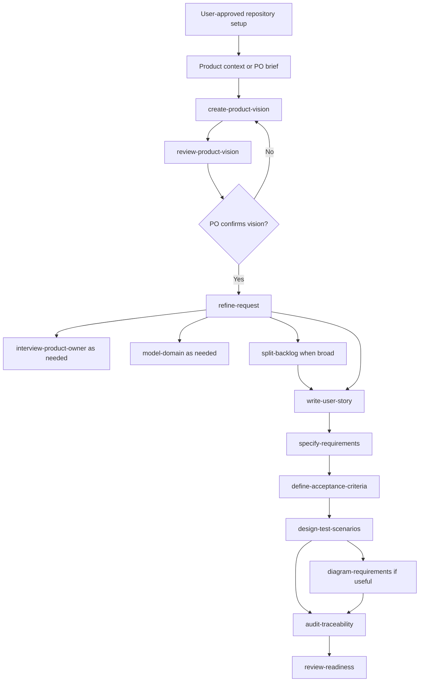

# Skill flow and decision gates

The diagram is a routing model, not a requirement to invoke every skill. A small, fully specified request may skip interview, modeling, epics and diagrams. A draft vision may support exploratory stories if explicitly labeled and accepted as provisional. No automatic approval. A scope-changing feature is escalated to the PO and traced back to vision revisions.
